<div align="center">


<a href="https://readme-typing-svg.demolab.com">
  
</a>

<br>


<br><br>

<a href="https://www.linkedin.com/in/pedro-cunha-eti/">
  
</a>
<a href="mailto:ped.cunha2204@gmail.com">
  
</a>
<a href="https://github.com/pedrocunha4">
  
</a>

<br><br>


</div>

---

## About

I'm a **Telecommunications and Informatics Engineering graduate from ISEP**, focused on **process automation, systems integration, backend development, data and applied AI**.

I have practical experience with **automation workflows, REST APIs, webhooks, databases, distributed systems, testing and monitoring**. I also work with **LLM-based solutions and AI-assisted workflows**, integrating AI into real operational processes.

I enjoy building end-to-end solutions that connect **backend services, data layers, automation platforms and lightweight interfaces**, with particular attention to **reliability, validation, security and maintainability**.

> **Open to:** Process Automation · Systems Integration · Junior Software Engineering · Data Engineering · Applied AI

---

## Tech Stack

### Languages

<p align="center">
  
  
  
  
  
</p>

### Frontend

<p align="center">
  
  
  
</p>

### Backend & Databases

<p align="center">
  
  
  
  
  
  
</p>

### Cloud, DevOps & Tooling

<p align="center">
  
  
  
  
  
  
  
  
</p>

---

## Applied AI & Automation

| Domain | Proficiency | Details |
|---|---|---|
| **LLM Integration** | Practical Experience | Structured extraction, prompt design, API-based LLM integration and AI-assisted workflows |
| **AI Automation** | Practical Experience | Automation with Make and n8n, APIs, webhooks, validation and fallback logic |
| **AI Agents** | Applied Learning | Agent-oriented automation concepts through Make Academy AI training |
| **Structured Extraction** | Practical Experience | Extracting structured business data from invoice content in InvoiceFlow AI |
| **Context & Prompt Engineering** | Working Knowledge | Designing prompts, structured outputs and context for reliable AI workflow behavior |

---

## Featured Projects

<details open>
<summary><strong>InvoiceFlow AI — AI-powered invoice processing and automation platform</strong></summary>

<br>

| Area | Details |
|---|---|
| **Stack** | Python · FastAPI · Streamlit · Groq · Supabase · PostgreSQL · Make · GitHub Actions |
| **Workflow** | PDF ingestion → AI extraction → validation → duplicate detection → private storage → human review → automation |
| **Reliability** | Business-rule validation, duplicate detection, error handling and backend cold-start handling |
| **Security** | API-key authentication, environment-based secrets, private Supabase Storage and temporary protected PDF access |
| **Engineering** | Automated tests, code quality checks, CI with GitHub Actions and cloud deployment |
| **Repository** | [github.com/pedrocunha4/invoiceflow-ai](https://github.com/pedrocunha4/invoiceflow-ai) |
| **Live Demo** | [invoiceflow-ai-demo.streamlit.app](https://invoiceflow-ai-demo.streamlit.app) · Access code: `invoiceflow` |

InvoiceFlow AI is an end-to-end portfolio project combining **AI-assisted document processing, backend engineering, data persistence, secure document handling, human review and workflow automation**.

</details>

---

## Experience

### Process Automation & Systems Integration Intern · TAO Intelligence
**Feb 2026 — Jul 2026 · Remote**

- Developed and automated operational processes through **n8n workflows**.
- Integrated systems, applications, **REST APIs, webhooks and databases**.
- Developed solutions using **AI and LLMs** inside operational workflows.
- Implemented business logic, data transformation and validation/fallback mechanisms.
- Tested, monitored and optimized automation workflows and integration solutions.

<p align="center">
  
  
  
  
  
  
</p>

---

## Key Highlights

| Highlight | Details |
|---|---|
| **Engineering Degree** | Telecommunications and Informatics Engineering graduate from ISEP, 2026 |
| **InvoiceFlow AI** | Designed, developed, tested and publicly deployed an end-to-end AI-powered invoice processing and automation platform |

---

## Certifications

### Make Academy

<p align="center">
  
  
  
  
  
  
</p>

---

## GitHub Analytics

<div align="center">


<br>


</div>

---

## Contribution Activity

<div align="center">



</div>

---

## Contribution Snake

<div align="center">


</div>

---

## Current Focus

```yaml
learning:
  - Data Engineering
  - Applied AI
  - AI Agents and reliable automation

building:
  - Production-style automation and integration projects
  - Backend services and API-driven workflows

exploring:
  - LLM integration
  - Agentic workflows
  - Data-intensive systems

open_to:
  - Process Automation
  - Systems Integration
  - Junior Software Engineering
  - Data Engineering
```

---

## Connect

<div align="center">

<a href="mailto:ped.cunha2204@gmail.com">
  
</a>
<a href="https://www.linkedin.com/in/pedro-cunha-eti/">
  
</a>
<a href="https://github.com/pedrocunha4">
  
</a>
<a href="https://github.com/pedrocunha4?tab=repositories">
  
</a>

</div>

---

<div align="center">

**Build systems that connect, automate and create measurable value.**


</div>
