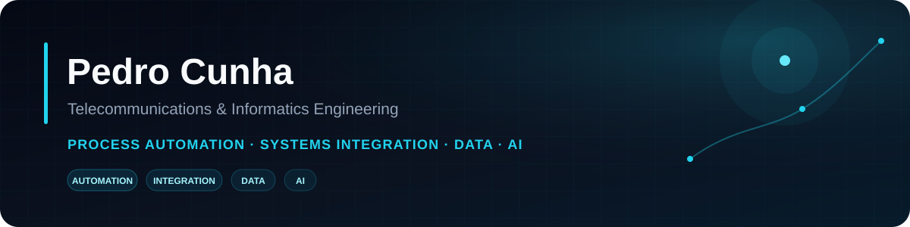

## About me

I'm a **Telecommunications and Informatics Engineering graduate from ISEP**, focused on **process automation, systems integration, data and applied AI**.

I have practical experience with automation workflows, REST APIs, webhooks, databases, testing, monitoring and technical documentation. I enjoy building end-to-end systems where automation, backend services, data and AI need to work together reliably.

## Core stack

  
  
  
  
  
  
  

  
  
  
  
  
  

<strong>More technologies</strong>

 

  
  
  
  
  
  
  
  
  

## Featured project

<table>
<tr>
<td>

### InvoiceFlow AI

**AI-powered invoice processing and automation platform.**

An end-to-end portfolio project combining PDF invoice processing, structured AI extraction, business validation, duplicate detection, private document storage, human review and external workflow automation.

**Stack:** Python · FastAPI · Streamlit · Groq · Supabase · PostgreSQL · Make · GitHub Actions

Public demo access code: <code>invoiceflow</code>

</td>
</tr>
</table>

## GitHub overview

 

## Activity

## Trophies

## Connect

  
  

---

  Automation · Systems Integration · Data · Applied AI

